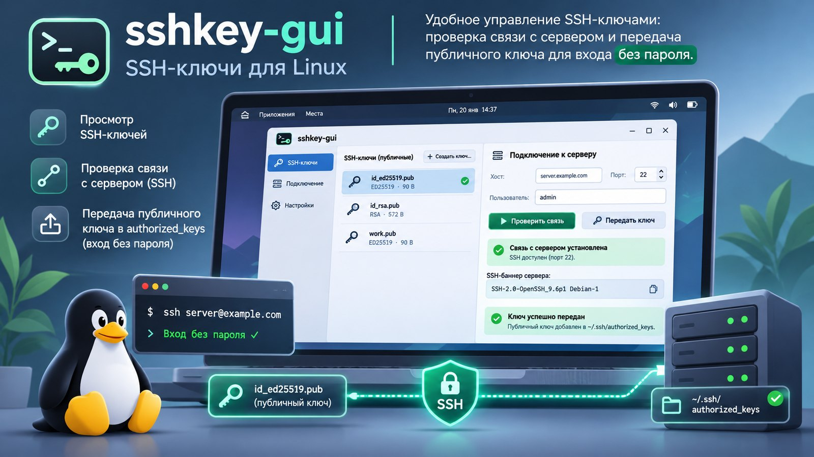

# SSH-ключи (sshkey-gui)



Небольшое десктопное приложение для Linux: показывает SSH-ключи, создаёт новые,
проверяет связь с сервером и передаёт публичный ключ, чтобы дальше входить без пароля.

**Версия:** 0.6.0 · **Лицензия:** MIT · **Автор:** kykis_rus

---

## Что умеет

- **Ключи.** Список `*.pub` из `~/.ssh` и дополнительных каталогов: тип, длина, отпечаток,
  комментарий. Видно, есть ли приватная пара — без неё ключ нельзя выбрать для передачи.
- **Создание ключа.** Кнопка «Создать ключ…» над списком: имя файла, тип
  (`ed25519`, `rsa` 4096, `ecdsa`), комментарий и необязательная парольная фраза.
  Права выставляет `ssh-keygen` (`600` на приватный ключ).
- **Проверка связи.** TCP-доступность и время отклика, SSH-баннер и — главное —
  пускает ли выбранный ключ уже сейчас.
- **Передача ключа.** Публичный ключ добавляется в `~/.ssh/authorized_keys` на сервере
  с правами `700`/`600`, без дубликатов, с автоматической проверкой входа после передачи.
- **Настройки.** Дополнительные каталоги с ключами и выгрузка ключей в архив `.tar.gz`.
- **Подключение** — раздел-заглушка, появится в следующих версиях.
- Своё окно (GTK3 + WebKit2), пункт в меню приложений и ярлык на рабочем столе.
  Сторонних Python-зависимостей нет — только стандартная библиотека и системные
  `ssh`, `ssh-keygen`, `bash`.

## Требования

- Linux с Python 3.8+.
- Для окна: GTK 3 и WebKit2 (`python3-gi`, `gir1.2-webkit2-4.1`). Если их нет,
  приложение откроется в браузере.
- `openssh-client` — используются системные `ssh` и `ssh-keygen`.
- `bash` на удалённом сервере (для установки ключа).

## Установка

### Linux — пакет `.deb`

Скачайте `sshkey-gui_<версия>_all.deb` со страницы
[Releases](https://github.com/kykisrus/sshkey-gui/releases) и установите:

```bash
sudo apt install ./sshkey-gui_0.6.1_all.deb
```

После установки приложение появится в меню как **SSH-ключи**, а в терминале станет
доступна команда `sshkey-gui`. Зависимости (`python3`, `python3-gi`,
`gir1.2-webkit2-4.1`, `openssh-client`) `apt` поставит сам.

Удаление:

```bash
sudo apt remove sshkey-gui
```

### Windows — `sshkey-gui.exe`

Скачайте `sshkey-gui.exe` со страницы Releases и запустите — установка не требуется.
Нужен Windows 10 или 11 со встроенным клиентом OpenSSH (`ssh.exe`, обычно уже есть в
`C:\Windows\System32\OpenSSH`). Окна GTK в Windows нет, поэтому интерфейс откроется
в браузере, а консольное окно приложения должно оставаться открытым, пока вы работаете.

Особенности на Windows: создание ключей и просмотр списка работают полностью,
передача ключа с паролем через GUI может не сработать из-за различий в askpass —
в этом случае используйте ключ без пароля или `ssh-copy-id` из WSL.

### Из исходников

```bash
git clone git@github.com:kykisrus/sshkey-gui.git
cd sshkey-gui
./install.sh
```

Или, если архив уже скачан: распаковать и запустить `./install.sh` из папки проекта.
Пакет `.deb` можно собрать самому: `./packaging/build-deb.sh` (результат в `dist/`).

Скрипт раскладывает приложение в `~/.local/share/sshkey-gui` и создаёт:

- `~/.local/bin/sshkey-gui` — лаунчер;
- `~/.local/share/applications/sshkey-gui.desktop` — пункт меню «SSH-ключи»;
- `~/.local/share/icons/hicolor/scalable/apps/sshkey-gui.svg` — иконку;
- ярлык на рабочем столе (если он есть).

Удаление:

```bash
./install.sh --uninstall
```

## Запуск

- из меню приложений — **SSH-ключи**;
- из терминала — `sshkey-gui`;
- без установки, из папки проекта — `python3 desktop.py` (окно) или
  `python3 app.py` (только веб-интерфейс в браузере).

Переменные окружения:

| Переменная | По умолчанию | Назначение |
|---|---|---|
| `SSHKEY_GUI_PORT` | `8765` | порт локального интерфейса |
| `SSHKEY_GUI_SSH_DIR` | `~/.ssh` | основной каталог ключей |
| `SSHKEY_GUI_CONFIG_DIR` | `~/.config/sshkey-gui` | каталог настроек |

## Как пользоваться

1. Слева выберите ключ. Если для `*.pub` нет приватной пары, ключ выбрать нельзя.
2. Справа укажите IP или хост сервера, порт (по умолчанию 22) и пользователя.
3. **Проверить связь** — покажет доступность, SSH-баннер и работает ли ключ.
4. Если вход по паролю — введите пароль в поле «Пароль» и нажмите **Передать ключ**.
5. Приложение добавит ключ и сразу перепроверит вход по нему.

Поля формы намеренно пустые при каждом запуске: реальные адреса и логины нигде
не сохраняются.

### Создать ключ

Кнопка **+ Создать ключ…** над списком. Имя — латиница, цифры, точка, дефис и
подчёркивание. Ключ создаётся в основном каталоге ключей. Если файл с таким именем
уже есть, приложение откажет, ничего не перезаписывая.

### Настройки

- **Каталоги с ключами** — дополнительные абсолютные пути. Они сканируются вместе
  с основным; список хранится в `~/.config/sshkey-gui/settings.json`.
- **Выгрузка ключей** — архив `.tar.gz` с публичными ключами из всех каталогов.
  Приватные ключи попадают в архив только если отметить соответствующий пункт:
  это секрет, архив нужно хранить в защищённом месте.
- **Подключение** пока недоступно — раздел помечен «скоро».

## Как именно передаётся ключ

`ssh-copy-id` не используется — он создаёт временный каталог в `~/.ssh`, что мешает
в песочницах и контейнерах. Вместо этого по SSH выполняется короткий скрипт на сервере:

```sh
umask 077
mkdir -p ~/.ssh
touch ~/.ssh/authorized_keys
chmod 700 ~/.ssh
chmod 600 ~/.ssh/authorized_keys
# ключ добавляется, только если его там ещё нет
```

Строка ключа передаётся на удалённую сторону и экранируется через `shlex.quote`,
поэтому спецсимволы в комментарии ключа безопасны. Повторный запуск не создаёт
дубликатов: вторая передача вернёт `PRESENT` вместо `ADDED`.

Для передачи с паролем используется одноразовый askpass-скрипт в `/tmp` (права `700`),
который удаляется сразу после попытки. Пароль в него не записывается — скрипт читает
переменную окружения процесса.

## Приватность и безопасность

Приложение не имеет сети, кроме той, что вы указали сами.

**Что передаётся наружу**

- На выбранный вами сервер по SSH: **только одна строка — публичный ключ** из
  `~/.ssh/<ключ>.pub`, которую вы видите в приложении.
- Ничего больше: ни приватных ключей, ни паролей, ни списка файлов, ни имени
  пользователя, ни телеметрии.

**Что не покидает машину**

- Приватный ключ. Приложение его не читает и не копирует — за него работает
  системный `ssh`.
- Пароль. Живёт только в памяти процесса и в переменной окружения одноразового
  askpass-скрипта; в файлы, логи и историю не попадает. После передачи поле очищается.
- Список ключей, отпечатки, выгруженный архив. Всё это отдаётся только локальному
  интерфейсу на `127.0.0.1`.
- Файл настроек `~/.config/sshkey-gui/settings.json` содержит только список
  дополнительных каталогов.

**Сетевой доступ**

- HTTP-сервер слушает только `127.0.0.1` — снаружи машины он недоступен.
- Принимаются только запросы с заголовком `Host: 127.0.0.1:<порт>` или `localhost:<порт>`,
  что закрывает DNS-rebinding.
- В HTML нет внешних ресурсов: ни CDN, ни шрифтов, ни аналитики, ни трекеров.
- В журнал процесса пишутся только метод и путь запроса, без тел и паролей.

**Ограничения**

- Любой процесс на этой же машине под тем же пользователем теоретически может
  обратиться к `127.0.0.1:8765`. Приложение — локальный инструмент для одного человека,
  а не многопользовательский сервис.
- Ключи, защищённые парольной фразой, не поддерживаются при передаче: askpass отдаёт
  только пароль сервера.
- Передача работает там, где разрешён вход по паролю. Если сервер разрешает только
  ключи, добавлять их нужно другим способом.
- Отпечатки хостов не запоминаются: при первом подключении действует
  `StrictHostKeyChecking=accept-new`.

## Структура проекта

```
sshkey-gui/
├── app.py              # локальный HTTP-сервер и вся логика
├── desktop.py          # окно GTK3 + WebKit2 (фолбэк — браузер)
├── static/index.html   # интерфейс (HTML/CSS/JS, без внешних зависимостей)
├── icon.svg            # иконка приложения
├── docs/hero.jpg       # изображение для README
├── install.sh          # установка и удаление
├── run.sh              # запуск из папки проекта
├── README.md
├── SECURITY.md
├── CHANGELOG.md
├── LICENSE
└── VERSION
```

## API локального интерфейса

| Метод | Путь | Назначение |
|---|---|---|
| `GET` | `/` | страница интерфейса |
| `GET` | `/api/keys` | ключи из всех каталогов, версия |
| `POST` | `/api/check` | TCP-проверка и проверка входа по ключу |
| `POST` | `/api/copy` | установка публичного ключа и проверка |
| `GET` | `/api/settings` | дополнительные каталоги, пути настроек |
| `POST` | `/api/settings` | сохранить список дополнительных каталогов |
| `POST` | `/api/keygen` | создать новый SSH-ключ |
| `GET` | `/api/export` | архив ключей: `?private=0` или `?private=1` |

Пример проверки:

```bash
curl -s -X POST http://127.0.0.1:8765/api/check \
  -H 'Content-Type: application/json' \
  -d '{"host":"<сервер>","port":22,"user":"<пользователь>","key":"<путь к приватному ключу>"}'
```

## Проверка перед публикацией

```bash
python3 desktop.py --selftest   # поднимает сервер и проверяет страницу
```

Поиск внешних ресурсов и личных данных в коде:

```bash
grep -rnE 'https?://|urllib|requests\.' app.py desktop.py static/index.html
grep -rInE '[0-9]{1,3}(\.[0-9]{1,3}){3}' . --exclude-dir=.git
```

## Лицензия

MIT. Полный текст — в файле [LICENSE](LICENSE).

Copyright (c) 2026 kykis_rus
